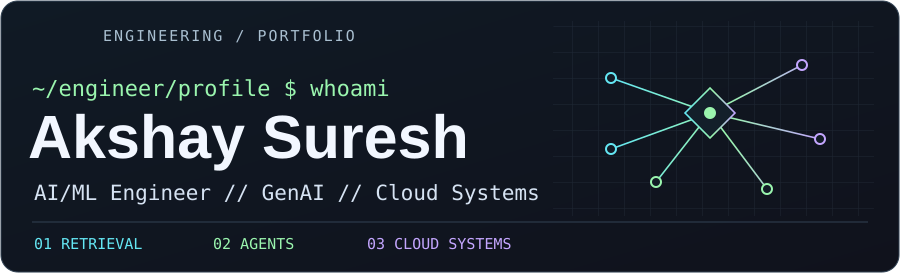
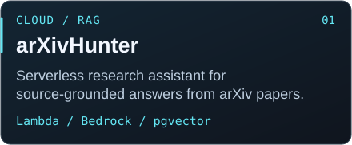
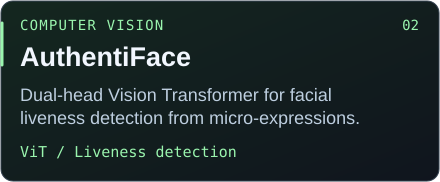
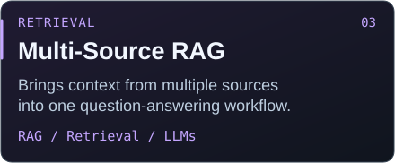
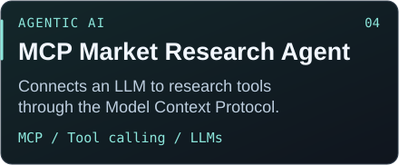

  <a href="https://www.linkedin.com/in/akshay-suresh-b63606217">LinkedIn</a> ·
  <a href="mailto:akshay.mleng@gmail.com">Email</a>

## System Overview

I build machine learning and LLM applications, from retrieval and evaluation to cloud deployment. My work includes candidate and job search at Jobiak, forecasting and recommendations at GBS Systems, and ECG analysis at Techindia. I earned an M.S. in Applied Machine Learning from the University of Maryland.

## Current Focus

- **Retrieval** · Multi-source RAG and evaluation of source-grounded answers.
- **Agents** · LLM workflows that use tools through the Model Context Protocol.
- **Cloud** · Serverless ingestion and LLM inference optimization.

## Selected Work

<table>
<tr>
<td width="50%"> <a href="https://github.com/akshay-002/ServerlessRAG">Serverless Research Assistant ↗</a></td>
<td width="50%"> <a href="https://github.com/akshay-002/AuthentiFace">AuthentiFace repository ↗</a></td>
</tr>
<tr>
<td width="50%"></td>
<td width="50%"></td>
</tr>
</table>

## Tech Core

Transformers · Hugging Face · SQL · pgvector · Amazon Bedrock · AWS Lambda · SageMaker · AWS CDK
