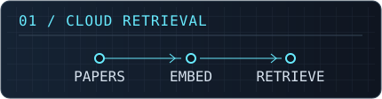
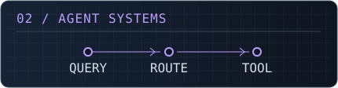
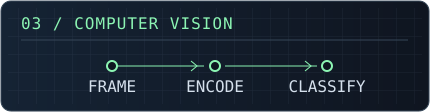
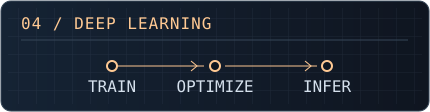
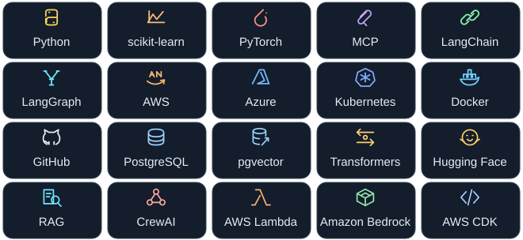

   ·
   · 

I build AI systems that retrieve evidence, use tools, and run in the cloud. My current focus is making retrieval easier to evaluate and agent workflows easier to trace.

## Selected Projects

<table>
<tr>
<td width="50%" valign="top">
 
<strong><a href="https://github.com/akshay-002/ServerlessRAG">ServerlessRAG</a></strong> 
Serverless research assistant for asking questions about arXiv papers. AWS Lambda · Bedrock · pgvector
</td>
<td width="50%" valign="top">
 
<strong><a href="https://github.com/akshay-002/TT-T-Agentic-Support">TT-T-Agentic-Support</a></strong> 
Telecom support assistant that combines local LLMs, hybrid retrieval, and MCP tools. CrewAI · MCP · FastAPI
</td>
</tr>
<tr>
<td width="50%" valign="top">
 
<strong><a href="https://github.com/akshay-002/AuthentiFace">AuthentiFace</a></strong> 
Dual-head Vision Transformer for facial liveness detection from micro-expressions. Vision Transformer · Liveness detection
</td>
<td width="50%" valign="top">
 
<strong><a href="https://github.com/akshay-002/IMAGE-SEGMENTATION-WITH-U-NET">IMAGE-SEGMENTATION-WITH-U-NET</a></strong> 
Predicts pixel-level segmentation masks with U-Net. Includes training and prediction notebooks, sample inputs, and a saved model. U-Net · Jupyter · Segmentation
</td>
</tr>
</table>

[Browse all repositories ↗](https://github.com/akshay-002?tab=repositories)

## Tech Core

**Programming** · Python

**Machine learning** · scikit-learn, PyTorch

**LLM and agent workflows** · MCP, LangChain, LangGraph

**Cloud and delivery** · AWS, Azure, Kubernetes, Docker, GitHub

**Data and supporting tools** · PostgreSQL, pgvector, Transformers, Hugging Face, RAG, CrewAI, AWS Lambda, Amazon Bedrock, AWS CDK

